# Habitize

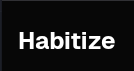

> A modern, intuitive habit-tracking web application built with Next.js, Supabase, and TypeScript

[](https://opensource.org/licenses/MIT)
[](https://www.typescriptlang.org/)
[](https://nextjs.org/)
[](https://supabase.com/)

## Overview

Habitize is a comprehensive habit-tracking application that helps you build better daily routines. Track your habits, record memorable moments, and monitor your sleep patterns all in one beautiful, user-friendly interface.

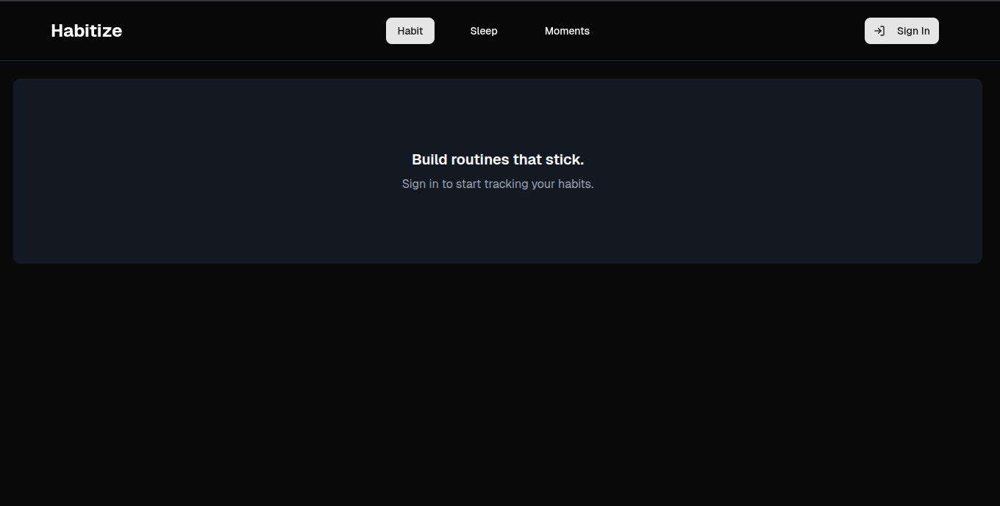

## Features

### Habit Tracking System
- **Multiple Habit Types**: Support for boolean (done/not done) and counter-based habits
- **Customizable Frequency**: Daily, weekly, interval-based, or custom day scheduling
- **Color-Coded Categories**: Organize habits with custom colors and categories
- **Progress Visualization**: Visual progress indicators and completion tracking
- **Habit Streaks**: Track current and longest streaks for motivation
- **Smart Notifications**: Configurable reminders with quiet hours support

### Memorable Moments
Capture your daily highlights and reflections with a simple text note. Each day, record one meaningful moment that you want to remember.

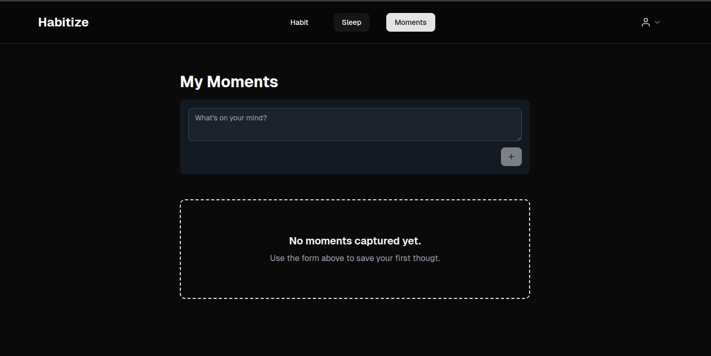

### Sleep Tracking
Log your sleep hours and visualize your sleep patterns with beautiful monthly charts. Understanding your sleep trends has never been easier.

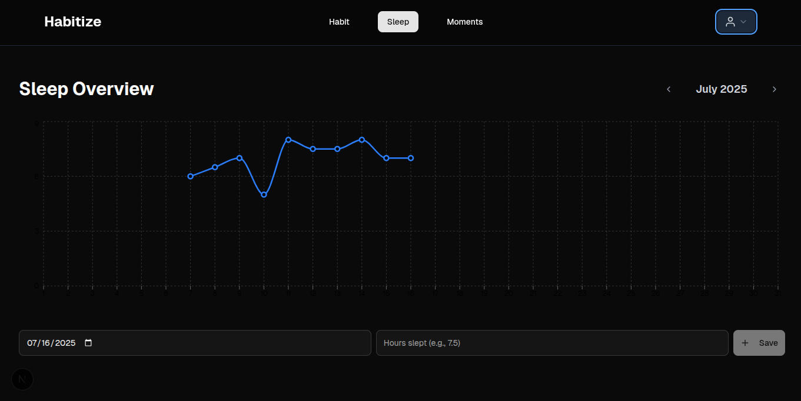

### Advanced Statistics
- **Completion Analytics**: Daily completion rates and habit performance metrics
- **Habit Distribution**: Visual breakdown of habit consistency levels
- **Performance Charts**: Interactive charts showing progress over time
- **Monthly Comparisons**: Track improvement across different time periods

### User Experience
- **Secure Authentication**: Full user authentication system with email/password and Google OAuth
- **Mobile Responsive**: Fully responsive design that works seamlessly across all devices
- **Dark/Light Theme**: Automatic theme detection with manual override
- **Progressive Web App**: Installable PWA with offline capabilities

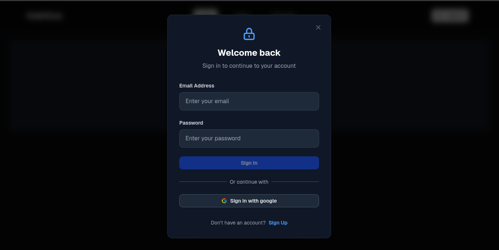

## Tech Stack

- **Frontend**: Next.js 15 (App Router), TypeScript, Tailwind CSS
- **UI Components**: shadcn/ui, Lucide React icons, Headless UI
- **Backend**: Supabase (PostgreSQL, Auth, Row Level Security)
- **State Management**: Zustand, React Context, SWR for data fetching
- **Styling**: Tailwind CSS with custom design system
- **Charts**: Recharts for data visualization
- **Forms**: React Hook Form with Zod validation
- **Notifications**: Sonner toast notifications

## Project Structure

```
habitize/
├── app/                    # Next.js App Router pages &layouts
       # Main app dashboard
│   ├── reset-password/    # Password reset flow
│   ├── callback/          # OAuth callback handler
│   └── globals.css        # Global styles
├── components/            # Reusable UI components
│   ├── ui/               # shadcn/ui components
│   ├── AuthModal.tsx     # Authentication modal
│   ├── ForgotPasswordPage.tsx # Password reset
│   ├── Habits.tsx        # Habit tracking interface
│   ├── Header.tsx        # Navigation component
│   ├── Moments.tsx       # Memorable moments
│   ├── SleepGraph.tsx    # Sleep visualization
│   └── Stats.tsx         # Analytics dashboard
├── context/              # React Context providers
│   ├── AuthContext.tsx   # Authentication context
│   ├── HabitContext.tsx  # Habit management context
│   ├── PageContext.tsx   # Active page context
│   ├── SupabaseContext.tsx # Supabase client context
│   └── ThemeContext.tsx  # Theme management
├── hooks/                # Custom React hooks
│   ├── useAuth.ts        # Authentication hook
│   ├── useAuthForm.ts    # Auth form management
│   ├── useHabits.ts      # Habit management hook
│   ├── useMediaQuery.ts  # Responsive design hook
│   ├── useMoment.ts      # Daily moments hook
│   └── useSleepLogs.ts   # Sleep tracking hook
├── lib/                  # Utilities and configurations
│   └── supabase.ts       # Supabase client configuration
├── store/                # Global state management
│   └── authStore.ts      # Authentication store (Zustand)
├── types/                # TypeScript type definitions
│   └── habit.ts          # Habit-related types
└── public/               # Static assets
    └── images/           # App screenshots and assets
```

## Database Schema

The application uses a comprehensive Supabase database with the following tables and Row-Level Security (RLS) enabled:

### Core Tables
- **`habits`**: User-defined habits with type, frequency, and target settings
- **`habit_logs`**: Daily habit completion records with progress tracking
- **`habit_categories`**: Categorization system for habits
- **`habit_streaks`**: Streak tracking and statistics
- **`habit_notifications`**: Reminder and notification configurations
- **`habit_templates`**: Pre-defined habit templates for quick creation

### Additional Features
- **`memorable_moments`**: Daily journal entries and reflections
- **`sleep_logs`**: Sleep duration and quality tracking
- **`user_preferences`**: User settings and customization options

### Database Views
- **`habit_statistics`**: Aggregated habit performance metrics
- **`todays_habits`**: Optimized view for daily habit display

### Key Database Functions
- **`calculate_completion_percentage`**: Computes progress for counter-based habits
- **`update_habit_streak`**: Maintains and updates streak information

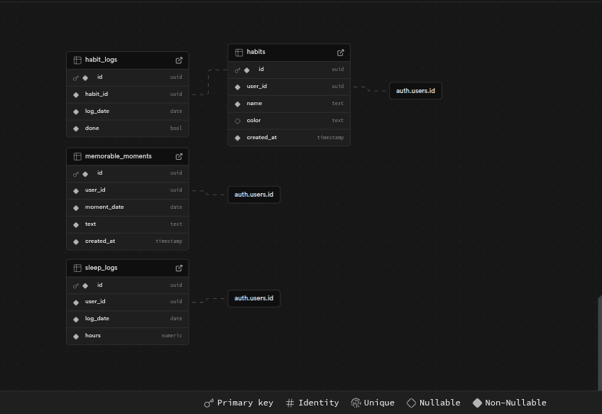

## Key Components

### Habit Management
- **Habit Creation**: Comprehensive form with type selection, frequency settings, color coding, and target goals
- **Habit Grid**: Interactive calendar view with toggle functionality for boolean habits and increment/decrement for counter habits
- **Progress Visualization**: Visual indicators showing completion status and progress toward goals
- **Habit Actions**: Archive, delete, and management options with confirmation flows

### Authentication System
- **Multi-provider Auth**: Email/password and Google OAuth support
- **Secure Session Management**: Automatic token refresh and session persistence
- **Password Recovery**: Secure password reset flow with email verification
- **Protected Routes**: Route protection with authentication guards

### Data Visualization
- **Sleep Charts**: Interactive line charts showing sleep patterns over time
- **Habit Analytics**: Bar charts, pie charts, and area charts for habit performance
- **Progress Tracking**: Visual representations of completion rates and streaks
- **Responsive Charts**: Mobile-optimized chart components

### User Interface
- **Responsive Navigation**: Adaptive header with mobile bottom navigation
- **Theme System**: Dark/light mode with system preference detection
- **Loading States**: Skeleton screens and progress indicators
- **Error Handling**: User-friendly error messages and recovery flows

## Mobile Responsiveness

Habitize is fully responsive and provides an optimized experience across all devices:

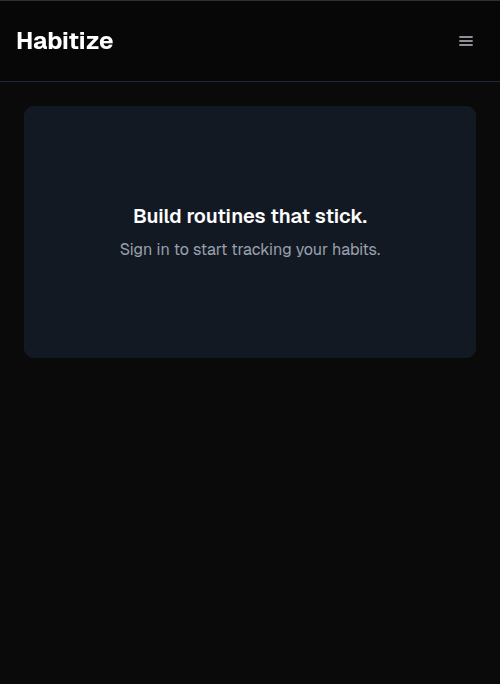
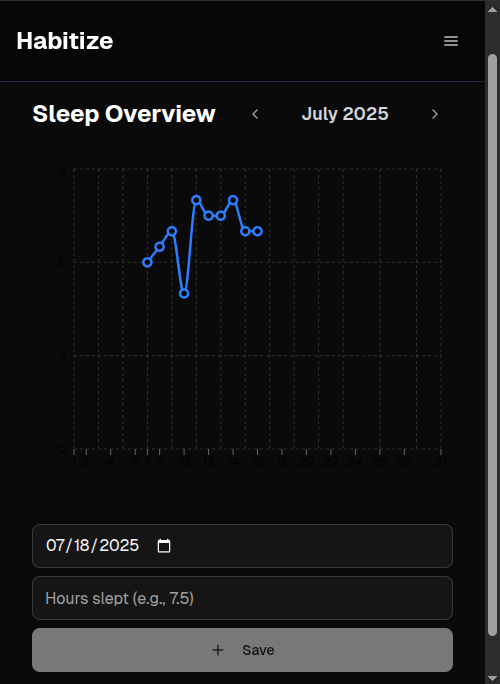
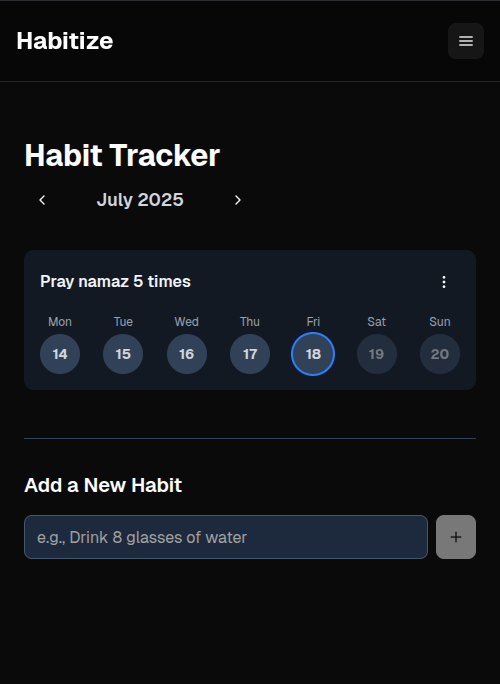
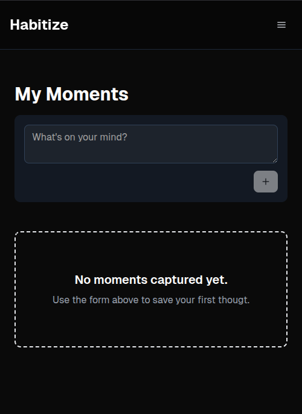
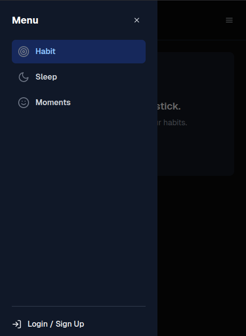

The mobile experience features:
- Bottom navigation bar for easy access to main sections
- Touch-optimized habit toggles and counters
- Responsive charts and data visualizations
- Mobile-first form designs and interactions

## Getting Started

### Prerequisites
- Node.js 18+ 
- npm or yarn
- Supabase account

### Installation

1. **Clone the repository**
   ```bash
   git clone https://github.com/kashan16/habitize.git
   cd habitize
   ```

2. **Install dependencies**
   ```bash
   npm install
   ```

3. **Environment Setup**
   Create a `.env.local` file with your Supabase credentials:
   ```env
   NEXT_PUBLIC_SUPABASE_URL=your_supabase_url
   NEXT_PUBLIC_SUPABASE_ANON_KEY=your_supabase_anon_key
   ```

4. **Database Setup**
   Run the database migrations located in the `supabase/migrations/` directory to set up the required tables and security policies.

5. **Start Development Server**
   ```bash
   npm run dev
   ```

6. **Open your browser**
   Navigate to `http://localhost:3000`

### Building for Production

```bash
npm run build
npm start
```

## Development

### Code Quality
- **TypeScript**: Full type safety across the application
- **ESLint**: Code linting with Next.js recommended rules
- **Prettier**: Consistent code formatting

### Available Scripts
- `npm run dev` - Start development server
- `npm run build` - Build for production
- `npm run start` - Start production server
- `npm run lint` - Run ESLint
- `npm run type-check` - Run TypeScript compiler checks

### Architecture Patterns
- **Component Composition**: Reusable UI components with shadcn/ui
- **Custom Hooks**: Logic abstraction for data fetching and state management
- **Context Providers**: Global state management for auth, habits, and UI state
- **Server-Side Rendering**: Next.js App Router for optimal performance

## Contributing

We welcome contributions from the community! Here's how to get started:

1. **Fork the repository**
2. **Create a feature branch**
   ```bash
   git checkout -b feature/amazing-feature
   ```
3. **Set up development environment**
   Follow the installation steps above
4. **Make your changes**
5. **Run tests and linting**
   ```bash
   npm run lint
   npm run type-check
   ```
6. **Commit your changes**
   ```bash
   git commit -m "feat: add amazing feature"
   ```
7. **Push to your branch**
   ```bash
   git push origin feature/amazing-feature
   ```
8. **Open a Pull Request**

### Contribution Guidelines

- Follow [Conventional Commits](https://www.conventionalcommits.org/) for commit messages
- Ensure all tests pass and code is properly linted
- Add appropriate documentation for new features
- Keep PRs focused and atomic
- Update types and database schema when adding new features
- Test across different screen sizes and devices

### Code Style
- Use TypeScript for all new code
- Follow the existing component patterns
- Use Tailwind CSS for styling
- Prefer composition over inheritance
- Write descriptive variable and function names

## License

This project is licensed under the MIT License - see the [LICENSE](LICENSE) file for details.

## Author

**Kashan Yunus** - [@kashan16](https://github.com/kashan16)

## Acknowledgments

- [Next.js](https://nextjs.org/) for the amazing React framework and App Router
- [Supabase](https://supabase.com/) for the backend infrastructure and real-time capabilities
- [shadcn/ui](https://ui.shadcn.com/) for the beautiful and accessible UI components
- [Tailwind CSS](https://tailwindcss.com/) for the utility-first CSS framework
- [Lucide React](https://lucide.dev/) for the comprehensive icon library
- [Recharts](https://recharts.org/) for the responsive charting library
- [Zustand](https://github.com/pmndrs/zustand) for simple and effective state management
- [date-fns](https://date-fns.org/) for date manipulation utilities

## Support

If you encounter any issues or have questions:

1. Check the [Issues](https://github.com/kashan16/habitize/issues) page for existing solutions
2. Create a new issue with detailed information about your problem
3. Join our [discussions](https://github.com/kashan16/habitize/discussions) for general questions and feature ideas

For documentation and additional resources:
- Review the code comments and type definitions
- Check the Supabase documentation for database-related questions
- Refer to the Next.js documentation for framework-specific issues

---

<div align="center">
  <strong>Built with dedication by Kashan Yunus</strong>
  <br>
  <em>Track your habits. Transform your life.</em>
</div>